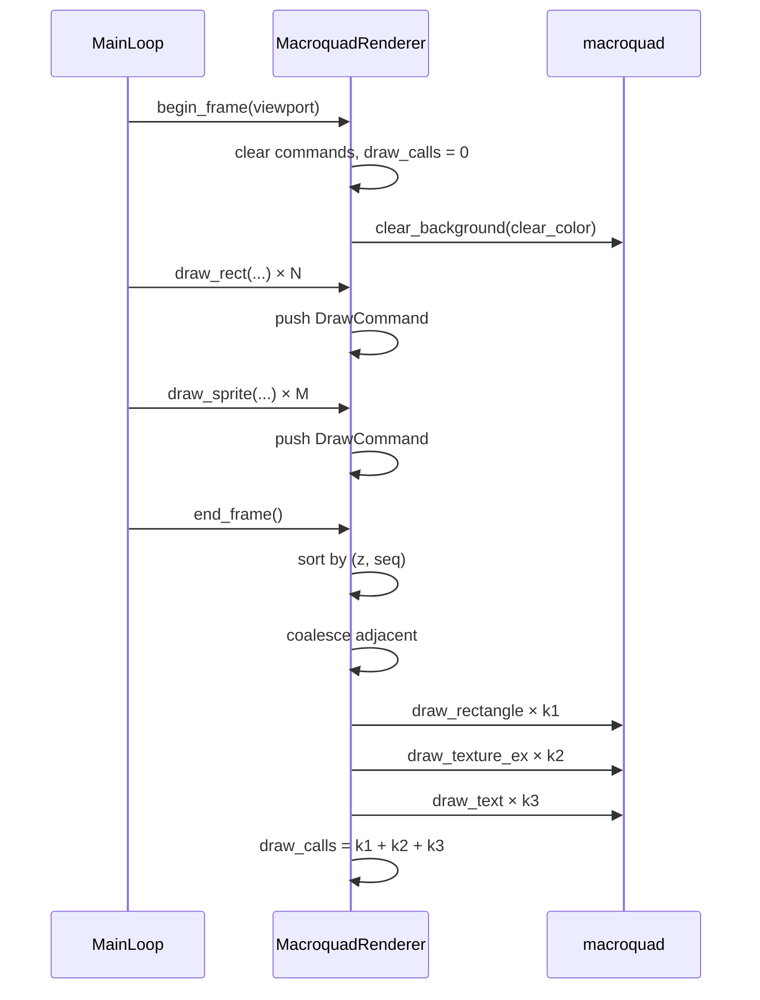

# 23 — `ember_render_macroquad`

> **Status:** ⬜ draft
> **Audience:** implementers
> **Prerequisites:** [22-ember-servers.md](22-ember-servers.md)

## 1. Purpose

Specify the reference `RenderingServer` implementation on
macroquad/miniquad. This is the crate that actually talks to the GPU.
It is the **only** crate in the workspace allowed to import
`macroquad::prelude` (see [02-principles I2](02-principles.md#i2--only-the-_macroquad-crates-depend-on-macroquad)).

## 2. Module layout

```
ember_render_macroquad/
├── Cargo.toml
├── src/
│   ├── lib.rs
│   ├── renderer.rs     MacroquadRenderer
│   ├── textures.rs     texture upload/cache
│   ├── batching.rs     draw call batching
│   ├── text.rs         font handling
│   ├── shaders.rs      built-in shader set
│   └── error.rs        RenderError
```

## 3. `MacroquadRenderer`

### 3.1 Struct

```rust
pub struct MacroquadRenderer {
    // frame state
    viewport: Rect,
    camera: Vec2,
    current_z: f32,
    clear_color: Color,

    // textures
    textures: HashMap<TextureId, Texture2D>,
    next_texture_id: u64,

    // shaders
    shaders: HashMap<ShaderId, Material>,
    active_shader: Option<ShaderId>,
    next_shader_id: u32,

    // stats
    draw_calls: u32,
}
```

### 3.2 Constructor

```rust
impl MacroquadRenderer {
    /// Creates the renderer. Must be called after macroquad's context is
    /// initialised (i.e. from inside `#[macroquad::main]`).
    pub fn new() -> Result<Box<dyn RenderingServer>, ServerError>;
}
```

The constructor is trivial — no GPU work happens until the first
`create_texture` or `begin_frame`.

### 3.3 Trait impl strategy

Every method maps to a small macroquad call. The renderer adds:

1. **Z-ordered batching** — see §5.
2. **Camera offset application** — see §4.
3. **Texture and shader lookup** — see §6 and §7.
4. **Draw-call counting** — see §8.

## 4. Camera and coordinates

### 4.1 `set_camera`

Stores the offset. Applied at `draw_*` time:

```rust
fn draw_rect(&mut self, rect: Rect, color: Color) {
    let screen_rect = Rect {
        x: rect.x - self.camera.x,
        y: rect.y - self.camera.y,
        w: rect.w,
        h: rect.h,
    };
    macroquad::shapes::draw_rectangle(
        screen_rect.x, screen_rect.y, screen_rect.w, screen_rect.h, to_mq_color(color),
    );
    self.draw_calls += 1;
}
```

### 4.2 Why offset (not matrix)

macroquads' immediate-mode API uses screen coordinates. Applying an
offset per call is cheaper than setting up a camera matrix on every
draw.

Games that need rotation or zoom use `RenderingServer::use_shader` with
a transform shader (v0.2). v0.1 is translate-only.

## 5. Z-ordered batching

### 5.1 The problem

Macroquad draws in call order. A scene with layers (background, tiles,
entities, UI) that draws nodes in tree order without z would draw tiles
over entities if a tile is processed first.

### 5.2 The solution

The renderer **buffers draw calls** between `begin_frame` and
`end_frame`, sorts them by `(z, sequence)`, then flushes.

```rust
enum DrawCommand {
    Rect { rect: Rect, color: Color, z: f32, seq: u64 },
    Sprite { texture: TextureId, dst: Rect, src: Option<Rect>, tint: Color, z: f32, seq: u64 },
    Text { text: String, pos: Vec2, size: f32, color: Color, z: f32, seq: u64 },
    // ...
}

struct BatchingState {
    commands: Vec<DrawCommand>,
    next_seq: u64,
}
```

At `end_frame`:

1. Stable-sort commands by `(z, seq)`.
2. Walk sorted commands, coalescing adjacent ones with the same texture
   (for sprites) or color (for rects).
3. Emit each group via macroquad.

### 5.3 Cost

One `Vec<DrawCommand>` allocation per frame (reused). One sort per frame
O(n log n) on ~1000 commands — under 50 µs on any modern CPU. For a
POC, this is fine; for a shipping engine, a radix sort on `(z, seq)`
would be the v0.2 optimization.

### 5.4 Why not skip batching in v0.1

Because z ordering is required by the scene model (see
[10-nodes-and-scenes §3.4](10-nodes-and-scenes.md#34-draw-order)).
Without batching, either z is ignored or the tree walk has to
pre-sort children — the latter is what causes the `NodeTree` to carry
a priority queue. Batching keeps `NodeTree` simple.

## 6. Texture management

### 6.1 `create_texture`

```rust
fn create_texture(&mut self, image: &Image) -> Result<TextureId, ServerError> {
    let mq_tex = macroquad::texture::Texture2D::from_image(&to_mq_image(image));
    let id = TextureId(self.next_texture_id);
    self.next_texture_id += 1;
    self.textures.insert(id, mq_tex);
    Ok(id)
}
```

`to_mq_image` copies the `Image::data` into macroquad's `Image` type.
No conversion cost beyond the copy.

### 6.2 `destroy_texture`

Removes from the map. When the `Texture2D` drops, macroquad frees the
GPU texture on the next frame.

### 6.3 `texture_size`

```rust
fn texture_size(&self, id: TextureId) -> Option<Vec2> {
    self.textures.get(&id).map(|t| Vec2::new(t.width(), t.height()))
}
```

### 6.4 Sprite batching

Consecutive `draw_sprite` calls with the same `TextureId` are coalesced
by the batcher into one macroquad `draw_texture_ex` call per sprite —
macroquad does not have a batched sprite API, so we accept N calls but
minimize state switches.

## 7. Shaders

### 7.1 Built-in shader set

v0.1 registers three shaders automatically:

| Name | Purpose |
|---|---|
| `"grayscale"` | Convert to grayscale (for disabled UI) |
| `"outline"` | Add an outline to sprites |
| `"shadow"` | Draw a shadow under a sprite |

`register_shader(name, source)` can add custom shaders, but the source
must be a macroquad `Material` shader string.

### 7.2 `use_shader`

```rust
fn use_shader(&mut self, shader: Option<ShaderId>) {
    self.active_shader = shader;
}
```

Subsequent draw calls use the active shader. Internally, this switches
macroquad's `material` for the draw call — no explicit flush needed.

### 7.3 Limitations

- v0.1 supports only macroquad `Material` shaders.
- No uniform binding beyond time and resolution.
- Arbitrary uniform support is a v0.2 feature.

## 8. Draw-call counting

`draw_call_count()` returns the number of macroquad draw calls executed
in the last frame. Used by the debug overlay and by profiling tests.

`begin_frame` resets the counter to 0; `end_frame` performs the actual
flush (which increments the counter for each emitted call).

## 9. Text rendering

### 9.1 `draw_text`

```rust
fn draw_text(&mut self, text: &str, pos: Vec2, size: f32, color: Color) {
    let screen_pos = pos - self.camera;
    macroquad::text::draw_text(
        text, screen_pos.x, screen_pos.y, size, to_mq_color(color),
    );
}
```

Uses macroquad's default font in v0.1. A loaded custom font overrides
this via `ember_assets` — the `Handle<Font>` resolves to a
`macroquad::text::Font` that the renderer caches.

### 9.2 `measure_text`

```rust
fn measure_text(&self, text: &str, size: f32) -> Vec2 {
    let dims = macroquad::text::measure_text(text, None, size as u16, 1.0);
    Vec2::new(dims.width, dims.height)
}
```

Returns pixel bounds. Used by `ember_ui` for layout.

## 10. Color conversion

macroquad's `Color` and `ember_core::Color` are field-identical
(`{ r, g, b, a }`, all `f32`). Conversion is a `#[repr(C)]` transmute,
or a one-line `From` impl:

```rust
fn to_mq_color(c: ember_core::Color) -> macroquad::prelude::Color {
    macroquad::prelude::Color { r: c.r, g: c.g, b: c.b, a: c.a }
}
```

## 11. Feature support

| Feature | Supported | Notes |
|---|---|---|
| `AlphaBlending` | ✅ | Default in macroquad |
| `CustomShaders` | ✅ | `Material`-based only |
| `TextureArray` | ❌ | macroquad has no texture arrays |
| `Instancing` | ❌ | macroquad is per-instance |
| `RenderToTexture` | ✅ | via `macroquad::texture::render_target` |

## 12. Frame lifecycle



## 13. Error handling

The only fallible operations are:

- `create_texture` — fails if the image is malformed or the GPU is out
  of memory.
- `register_shader` — fails if the source doesn't compile.

Everything else is infallible (draw calls to a nonexistent texture are
silently skipped, matching [02-principles §5.4](02-principles.md#54-what-is-never-an-error)).

## 14. Design notes

### 14.1 Why not use macroquad's camera

macroquad's `set_camera2d` is a full camera transform (position,
rotation, zoom). Most games use translate-only. Managing the camera in
the renderer keeps the trait's `set_camera(offset: Vec2)` simple, and
games that need rotation use a custom shader.

### 14.2 Why batch only at end_frame

If batching happened per `draw_*` call, each call would do a partial sort
and flush. Doing it once at `end_frame` gives the batcher full
visibility — it can merge sprites from different nodes if they happen
to share a texture and z.

### 14.3 Why copy images instead of zero-copy

`miniquad::Texture` takes ownership of its data. Copying an `Image`
into a `Texture2D` is a `Vec<u8>` clone — negligible for v0.1 asset
sizes (all under 1 MB).

### 14.4 Why not use `Texture2D::from_image` lazily

Because texture upload is fast (<1 ms for a 512×512 sprite), and doing
it at `create_texture` time keeps the asset lifecycle linear — assets
load, get uploaded, and are available immediately.

## 15. Open questions

- **Q1:** Should the renderer support a simple "scissor rectangle" for
  UI clipping? *Provisional:* yes — see [24-ember-ui.md](24-ember-ui.md).
  Adds `push_clip_rect` / `pop_clip_rect` to the `RenderingServer` trait.
- **Q2:** Should the renderer cache text layout? *Provisional:* no in
  v0.1. Text layout is cheap and caching risks invalidation bugs.
- **Q3:** Should the batcher use a radix sort? *Provisional:* only if
  profiling shows sort cost. v0.1 uses `sort_unstable_by_key`.
- **Q4:** Should we expose `draw_call_count` per frame or cumulative?
  *Provisional:* per-frame, reset at `begin_frame`.

## 16. Cross-references

- Server trait being implemented → [22-ember-servers.md §4](22-ember-servers.md#4-renderingserver)
- Why batched draws → [12-servers.md §4.3](12-servers.md#43-batch-semantics)
- Texture lifecycle → [25-ember-assets.md](25-ember-assets.md)
- The UI layer that uses clipping → [24-ember-ui.md](24-ember-ui.md)