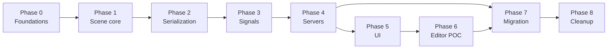
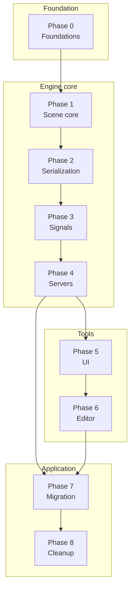

# 40 — Roadmap

> **Status:** ⬜ draft
> **Audience:** all
> **Prerequisites:** [00-overview.md](00-overview.md), [01-architecture.md](01-architecture.md)

## 1. Purpose

Define the phases of the v0.1 POC: what each phase builds, when it is
done, and what blocks what. This is the file you read before starting
work — to know which phase you are in, and what "done" means for it.

Every phase has:

- **Scope** — what is built.
- **Entry criteria** — what must be true to start.
- **Exit criteria** — what must be true to consider it done.
- **Deliverables** — the specific commits or documents.
- **Estimated effort** — a rough session count (not a firm commitment).

The phases are strictly sequential. Phase N+1 does not start until
Phase N's exit criteria are met.

## 2. The nine phases at a glance

Note the two parallel branches after Phase 4: UI + Editor can proceed
independently of Migration, which can begin with simple games before the
editor is finished.

## 3. Phase 0 — Foundations

### 3.1 Scope

- Extract `ember_stdlib::juice` from the 6 duplicate `juice.rs` files
  in games.
- Add `ember_core::main_loop` with the `MainLoop` trait and
  `run<L>()` helper.
- Rename `Cooldown::new` → `Cooldown::running`, `Cooldown::with_duration`
  → `Cooldown::ready`, add `#[deprecated]` aliases.
- Extend `ember_stdlib::input::Input` with `primary_action()`.

### 3.2 Entry criteria

- v0.1 docs Wave 1 and Wave 2 are marked ✅.

### 3.3 Exit criteria

- `cargo clippy --workspace --all-targets -- -D warnings` passes.
- `cargo test --workspace --no-fail-fast` passes.
- No game code changes required — the new APIs are additive.
- `ember_stdlib::juice` has unit tests.
- `MainLoop::run` has an integration test that spins up a headless loop
  and verifies `init` / `process` / `draw` / `finalize` order.

### 3.4 Deliverables

- `crates/ember_stdlib/src/juice.rs` (+ tests)
- `crates/ember_core/src/main_loop.rs` (+ tests)
- `crates/ember_core/src/time/cooldown.rs` updated with deprecations
- `crates/ember_stdlib/src/input.rs` updated with `primary_action`
- All 18 games' `juice.rs` files replaced with `use ember_stdlib::juice::*;`
- Workspace green

### 3.5 Estimated effort

1 session.

## 4. Phase 1 — Scene core

> **Progress:** 🟡 `NodeTree`, `NodeId`, contexts, `SceneLoop` and the
> ordering/stale-id tests are in. `crates/ember/examples/hello_scene.rs`
> runs the tree on macroquad via `ember::run_window` (runner and input
> poller live in `ember-render-macroquad`; `InputSink` in `ember-input`).
> Build-verified only; not run headlessly. Deviations: ADR-022.

### 4.1 Scope

- Add `crates/ember_scene`.
- Implement `Node` trait, `NodeId`, `NodeTree` (in-memory only).
- Implement `NodeContext` and `DrawContext`.
- Wire `NodeTree` into `MainLoop` (a `NodeTreeMainLoop` adapter that
  walks the tree each frame).
- **No serialization yet.** Nodes are constructed in code, not from
  `.escene` files.

### 4.2 Entry criteria

- Phase 0 complete.
- [21-ember-scene.md](21-ember-scene.md) marked ✅.

### 4.3 Exit criteria

- A hand-written test game (not one of the 18) can create a `NodeTree`,
  add a `Sprite` node, and render it via `ember_render_macroquad`.
- `NodeTree::process` order is verified by a test with 3 nodes that
  assert their `process` order.
- `NodeTree::ready` order is verified (bottom-up).
- Slotmap-based `NodeId` staleness is tested (remove a node, `get` on
  its id returns `None`).

### 4.4 Deliverables

- `crates/ember_scene/` with `node.rs`, `tree.rs`, `context.rs`,
  `error.rs`
- `crates/ember_scene/tests/tree_ordering.rs`
- `crates/ember_scene/tests/ready_ordering.rs`
- `crates/ember_scene/tests/stale_id.rs`
- A `examples/hello_scene.rs` in the workspace root

### 4.5 Estimated effort

2–3 sessions.

## 5. Phase 2 — Serialization

> **Progress:** 🟡 `ClassDB` (ADR-024), `Variant`, `PackedScene` /
> `.escene` (ADR-025) and `AssetServer` with UID registry, PNG
> textures and RON/scene assets (ADR-026) are in. Open: nested
> `instance:`, scene-declared connection wiring, hot-reload watching,
> audio/font loaders.

### 5.1 Scope

- Add `crates/ember_macros` with `#[derive(Node)]`, `#[signal]`,
  `#[export]`, `#[class_name]`.
- Add `PackedScene`, `SceneWriter`, `SceneReader` to `ember_scene`.
- Add `ClassDB` to `ember_core`.
- Add `crates/ember_assets` with `AssetServer`, `Handle<T>`,
  `AssetLoader`, UID registry.
- Add `crates/ember_render_macroquad` for `Texture`, `Font` loaders.

### 5.2 Entry criteria

- Phase 1 complete.
- [26-ember-macros.md](26-ember-macros.md),
  [30-escene-format.md](30-escene-format.md),
  [25-ember-assets.md](25-ember-assets.md) marked ✅.

### 5.3 Exit criteria

- `#[derive(Node)]` produces a struct that can be instantiated via
  `ClassDB::instantiate`.
- `PackedScene::from_file("player.escene")` round-trips through
  `to_ron()` without semantic change.
- A hand-written `player.escene` loads and instantiates into a
  `NodeTree`.
- `AssetServer` loads a PNG into a `TextureId` that
  `RenderingServer::draw_sprite` accepts.
- UID registry survives a process restart (the generated registry file
  is read on next startup).

### 5.4 Deliverables

- `crates/ember_macros/` with `derive_node.rs`, `signal.rs`,
  `export.rs`
- `crates/ember_core/src/class_db.rs`
- `crates/ember_scene/src/packed.rs`, `writer.rs`, `reader.rs`
- `crates/ember_assets/` (full crate)
- `crates/ember_render_macroquad/` (full crate)
- `assets/test_fixtures/player.escene` (round-trip fixture)
- Integration tests in every new crate

### 5.5 Estimated effort

4–5 sessions (this is the largest phase).

## 6. Phase 3 — Signals

> **Progress:** 🟡 `SignalTable`, `ScopedConnection`, typed
> `emit`/`emit_deferred`/`connect`/`disconnect` and the dispatch-order,
> stale-target, cycle and scoped-connection tests are in (landed ahead
> of Phase 2). Open: scene-declared connections (needs `.escene`) and
> the pong migration. Deviations: ADR-023.

### 6.1 Scope

- Add `SignalTable` to `ember_scene`.
- Implement typed `emit` / `connect` / `disconnect` on `NodeContext`.
- Implement `ScopedConnection`.
- Wire scene-declared connections (from `.escene`) to `SignalTable`.
- Implement deferred emission (`emit_deferred`).

### 6.2 Entry criteria

- Phase 2 complete.
- [11-signals.md](11-signals.md) marked ✅.

### 6.3 Exit criteria

- Pong's paddle→score path is migrated to a `Scored` signal (test
  without changing game logic otherwise).
- Signal dispatch order is deterministic (test with 3 handlers).
- Stale targets are silently skipped (test with despawn-then-emit).
- Cyclic signals don't stack-overflow (test with A↔B).
- `ScopedConnection` drop disconnects (test).

### 6.4 Deliverables

- `crates/ember_scene/src/signal.rs`
- `crates/ember_scene/tests/signal_dispatch_order.rs`
- `crates/ember_scene/tests/signal_stale_target.rs`
- `crates/ember_scene/tests/signal_cycle.rs`
- `crates/ember_scene/tests/scoped_connection.rs`
- A branch (`pong-signals-migration`) that switches pong to signals
  (not merged to main yet — waiting for Phase 7)

### 6.5 Estimated effort

2 sessions.

## 7. Phase 4 — Servers

### 7.1 Scope

- Add `crates/ember_servers` (traits only).
- Move `RenderingServer`, `AudioServer`, `PhysicsServer` traits into
  it.
- Move current `ember_render_macroquad` and add
  `ember_audio_macroquad`.
- Migrate `ember_stdlib::collider` into a `LinearPhysics` backend.
- Update `NodeContext` to hold `&mut dyn RenderingServer` etc.
- Add the CI checks from [01-architecture §5](01-architecture.md#5-enforcement).

### 7.2 Entry criteria

- Phase 3 complete.
- [22-ember-servers.md](22-ember-servers.md),
  [23-ember-render-macroquad.md](23-ember-render-macroquad.md) marked ✅.

### 7.3 Exit criteria

- `grep -rn "use macroquad" --include='*.rs' crates/` returns only
  hits in `ember_render_macroquad` and `ember_audio_macroquad`.
- `xtask check-layers` passes (no crate imports a higher layer).
- A test that creates a `MockRenderingServer` (recording draw calls)
  can drive a `NodeTree` and inspect the calls — proving the trait is
  the seam.
- All tests pass with `LinearPhysics`.

### 7.4 Deliverables

- `crates/ember_servers/` (full crate)
- `crates/ember_render_macroquad/` updated to implement
  `RenderingServer`
- `crates/ember_audio_macroquad/` (full crate)
- `crates/ember_servers/src/physics/linear.rs`
- `xtask/check-layers/`
- A `MockRenderingServer` fixture (in `ember_servers/tests/common/`)

### 7.5 Estimated effort

3 sessions.

## 8. Phase 5 — UI

### 8.1 Scope

- Add `crates/ember_ui`.
- Implement `Control` trait, `Anchors`, `VBox`, `HBox`, `Stretch`,
  `ScrollContainer`.
- Implement `Button`, `Label`, `Panel`, `TextInput`, `Image`.
- Implement `FocusManager`.
- Implement `Theme`.

### 8.2 Entry criteria

- Phase 4 complete.
- [24-ember-ui.md](24-ember-ui.md) marked ✅.

### 8.3 Exit criteria

- A demo scene renders a `VBox` with 3 `Button`s, navigable by keyboard
  (Tab moves focus, Enter activates).
- `ScrollContainer` clips its content correctly (visually verified).
- `TextInput` accepts and displays text.
- `Theme::dark()` produces a visible, non-broken UI.

### 8.4 Deliverables

- `crates/ember_ui/` (full crate)
- `crates/ember_ui/tests/layout_vbox.rs`
- `crates/ember_ui/tests/focus_navigation.rs`
- `crates/ember_ui/tests/scroll_clip.rs`
- An example game (`examples/ui_demo.rs`) that renders all widgets

### 8.5 Estimated effort

2–3 sessions.

## 9. Phase 6 — Editor POC

### 8.6 Scope

- Add `crates/ember_editor` (dev-only).
- Load a `.escene` file.
- Display the node tree in a side panel.
- Click a node to see its exported properties.
- Edit a property, see the value update in a preview.
- Save the modified scene back to disk.

### 9.1 Entry criteria

- Phase 4 and Phase 5 complete.
- [30-escene-format.md](30-escene-format.md) is ✅.

### 9.2 Exit criteria

- Editor opens `player.escene`, shows `Player / Sprite / Hitbox` in the
  tree.
- Clicking `Sprite` shows `texture` and `size` fields.
- Changing `size` from `(32, 32)` to `(64, 64)` updates the preview.
- Saving round-trips the change through `.escene`.

### 9.3 Deliverables

- `crates/ember_editor/` (full crate)
- `crates/ember_editor/tests/load_edit_save.rs`
- A CLI: `cargo run -p ember_editor -- path/to/scene.escene`

### 9.4 Estimated effort

3–4 sessions.

## 10. Phase 7 — Migration

### 10.1 Scope

Migrate all 18 games onto `MainLoop + NodeTree + Servers`. One game per
PR. Order matters — see [41-migration-guide.md](41-migration-guide.md).

### 10.2 Entry criteria

- Phases 0–6 complete.
- All Wave 3 docs ✅.

### 10.3 Exit criteria

Per-game:

- The game's `main.rs` is ≤ 10 lines.
- The game's `systems::update` body is unchanged (or minimally changed).
- All existing `game_scenarios.rs` tests pass.
- The game runs and behaves identically to pre-migration.

Global:

- All 18 games migrated.
- No game imports `macroquad` directly.
- `ember_stdlib::input` is still used by games for input (indirectly
  through `NodeContext`).

### 10.4 Deliverables

- 18 PRs, one per game, in the order defined by
  [41-migration-guide.md §3](41-migration-guide.md#3-migration-order)
- A `MIGRATION_LOG.md` recording per-game effort and unexpected issues
- Updated `game_scenarios.rs` files (unchanged behavior, adapted to new
  API)

### 10.5 Estimated effort

10–15 sessions (1 per game, some take 2).

## 11. Phase 8 — Cleanup

### 11.1 Scope

- Delete deprecated APIs (`Cooldown::new`, `Cooldown::with_duration`).
- Delete per-game `juice.rs` files (already unused since Phase 0).
- Delete per-game `audio.rs` files (already unused since Phase 4).
- Delete per-game `main.rs` boilerplate (already gone, but clean up any
  remaining fragments).
- Update `CHANGELOG.md` with the v0.1 release notes.

### 11.2 Entry criteria

- Phase 7 complete.

### 11.3 Exit criteria

- `grep -rn "Cooldown::new\|Cooldown::with_duration" crates/ games/`
  returns zero hits.
- `find games -name juice.rs` returns empty.
- `find games -name audio.rs` returns empty.
- `cargo test --workspace --no-fail-fast` green.
- `cargo clippy --workspace --all-targets -- -D warnings` green.

### 11.4 Deliverables

- Cleanup PRs (can be one big PR)
- Updated `CHANGELOG.md`

### 11.5 Estimated effort

1 session.

## 12. Dependency graph

The critical path is P0 → P1 → P2 → P3 → P4 → P7 → P8. Phase 5 and 6
branch from P4 in parallel with the start of P7 (migration of simple
games can begin before the editor exists).

## 13. Milestones

| Milestone | Phase | What the engine can do |
|---|---|---|
| M0 — Foundations | P0 | `Cooldown::ready()` is idiomatic; `MainLoop` exists; `juice` is shared |
| M1 — Trees work | P1 | A hand-written node tree renders |
| M2 — Scenes are files | P2 | A `.escene` file loads and runs |
| M3 — Nodes talk | P3 | Signals connect nodes without shared refs |
| M4 — Backends are swappable | P4 | `macroquad` is isolated to 2 crates |
| M5 — UI works | P5 | A menu can be built with `Button`, `VBox`, `Label` |
| M6 — Authoring works | P6 | A `.escene` can be edited outside code |
| M7 — POC complete | P7 | All 18 games run on the engine |
| M8 — v0.1 released | P8 | No deprecated APIs remain |

## 14. Cross-references

- Scope definition → [00-overview.md §5](00-overview.md#5-scope)
- Success criteria → [00-overview.md §6](00-overview.md#6-success-criteria)
- Per-game migration recipe → [41-migration-guide.md](41-migration-guide.md)
- `ember-wars` as the acceptance test → [42-acceptance-tests.md](42-acceptance-tests.md)
- Testing approach → [43-testing-strategy.md](43-testing-strategy.md)
- The decisions that led to this plan → [50-design-decisions.md](50-design-decisions.md)