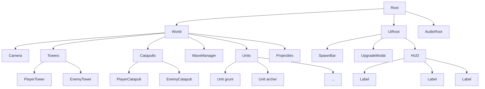

# 42 — Acceptance Tests

> **Status:** ⬜ draft
> **Audience:** implementers, reviewers
> **Prerequisites:** [40-roadmap.md](40-roadmap.md), [41-migration-guide.md](41-migration-guide.md)

## 1. Purpose

Define what "POC complete" means, concretely. The acceptance test is
`ember-wars` — the most complex game in the workspace. If it migrates
cleanly, the engine's primitives are correct. If it needs special
cases, they are not.

This document is the **gate**: no PR that touches the engine ships
until `ember-wars` passes its acceptance suite. No v0.1 release happens
until the whole acceptance suite is green.

## 2. Why `ember-wars`

`ember-wars` is the acceptance test because it exercises every
primitive:

| Feature | Uses in `ember-wars` |
|---|---|
| Waves | Wave manager, enemy spawner |
| AI | Enemy AI spawns units, chooses kinds |
| Units | 6 unit types (grunt, archer, brute, healer, bomber, hero) |
| Ranged combat | Archers fire projectiles |
| Melee combat | Grunts hit enemies |
| Healing | Healers restore allies |
| Suicide units | Bombers explode on contact |
| Catapults | Player and enemy, with trajectory solving |
| Projectiles | Parabolic, gravity, pierce, explosive |
| Multi-shot | Upgrades allow 3-shot catapults |
| Upgrades | 28-node upgrade tree |
| Progress | Chapter unlocks, star tiers, gold |
| Save/load | Progress persists |
| Status effects | Hit flash, floating text |
| Audio | Multiple SFX categories |
| Camera | Follows front-most combat |
| UI | Spawn bar, upgrade modal, HUD |
| Game state | Menu → Playing → Paused → Won/Lost |
| Chapters | 5 chapters × 3 levels |

No other game touches all of these. If `ember-wars` migrates, the engine
is complete for v0.1's scope.

## 3. The acceptance checklist

`ember-wars` migration is done when **all** of these are true. Each
item is testable.

### 3.1 Structural criteria

| # | Criterion | Verification |
|---|---|---|
| 1 | `games/ember-wars/src/main.rs` ≤ 10 lines | `wc -l` |
| 2 | `impl MainLoop for Game` exists in `game.rs` | `grep` |
| 3 | No `use macroquad` in `games/ember-wars/src/` | `grep` |
| 4 | No `use ember_stdlib::audio` — audio goes through `ctx.audio()` | `grep` |
| 5 | No `juice.rs`, no `audio.rs` | `ls` |
| 6 | `Vec<Unit>` replaced with `NodeId` references, or justified as a kept data structure | code review |
| 7 | `Vec<Projectile>` replaced with `NodeId` references, or justified | code review |
| 8 | `Catapult` and `Unit` are `#[derive(Node)]` | `grep` |

### 3.2 Behavioral criteria

| # | Criterion | Verification |
|---|---|---|
| 9 | All 316 existing lib tests pass | `cargo test -p ember-wars --lib` |
| 10 | All 20 scenario tests pass | `cargo test -p ember-wars --test game_scenarios` |
| 11 | Manual play-through of chapter 1 (levels 1-3) matches pre-migration video | visual |
| 12 | Manual play-through of chapter 2 (levels 4-6) matches | visual |
| 13 | Manual play-through of chapter 5 (levels 13-15) matches | visual |
| 14 | Upgrade tree UI works (open modal, buy node, see effect) | manual |
| 15 | Save/load round-trips progress | manual: play, quit, relaunch, continue |

### 3.3 Engine criteria (cross-cutting)

| # | Criterion | Verification |
|---|---|---|
| 16 | No new `unsafe` blocks introduced | `grep -c unsafe games/ember-wars/src/` unchanged |
| 17 | No new `unwrap()` in non-test code | `grep -rn "unwrap()" games/ember-wars/src/ --exclude=*test*` |
| 18 | No `RenderingServer` method added just for `ember-wars` | `git diff` on `ember_servers` |
| 19 | No `SceneError` variant added just for `ember-wars` | `git diff` on `ember_scene` |
| 20 | No `NodeContext` method added just for `ember-wars` | `git diff` on `ember_scene` |

Item 18–20 are the crucial ones. If migrating `ember-wars` requires
touching `ember_servers` or `ember_scene` to add a method only it uses,
the trait is wrong. The migration must be paused, and the trait must be
fixed for the general case — or the migration must be redesigned.

## 4. The `ember-wars` tree shape after migration

The goal of migration is not "make it compile" — it is "make it express
the game's structure in nodes". The target tree:



`World` is a "system node" — it owns `WaveManager` (which spawns units)
and drives the combat resolution. `Units` and `Projectiles` are
container nodes; individual units and projectiles are children.

This shape is the **proof** that the engine's primitives are correct.
If any of these nodes needs to reach across the tree with a path
instead of a `NodeId`, or downcast through `Any` in a way that a
non-`ember-wars` game doesn't, something is wrong.

## 5. Failure modes to watch

These are the specific failure modes we expect during `ember-wars`
migration. If any of them occurs, the migration stops and we file an
ADR.

### 5.1 "I need `&mut NodeTree` outside of `process`"

If a `World` system needs to iterate children and call their methods,
it goes through `ctx.tree().iter()` and `ctx.tree().get_mut()`. If that
pattern is too slow (O(n) per unit), the tree needs a spatial index —
which is a legitimate engine feature (add to `ember_servers::PhysicsServer`).

**Never** by adding a cached `Vec<NodeId>` on the `World` that's
manually kept in sync. That's a shadow tree, and it will drift.

### 5.2 "I need to know the type of a child at runtime"

If combat resolution needs `if child is Catapult`, the answer is:

- Downcast: `child.as_any().downcast_ref::<Catapult>()`.
- Or, use a signal: `emit::<Damaged>(...)` and let the catapult react.

If downcasting is used in `ember-wars` but not in simpler games, it's a
signal design smell — the interaction should be a signal, not a downcast.

### 5.3 "The upgrade tree needs to mutate the catapult"

Upgrades (e.g., `+20% catapult range`) modify the player's `Catapult`.
The catapult is a node. The upgrade tree is a data structure.

The pattern: `Catapult` connects to `UpgradePurchased` signal. When it
fires, it re-reads `progress.upgrades.catapult_range()` and updates its
own field.

If the pattern instead requires `UpgradeModal` to find the catapult
node and mutate it, something is wrong — `UpgradeModal` should not know
about `Catapult`.

### 5.4 "WaveManager needs to iterate all units"

`WaveManager` doesn't iterate all units — it emits `WaveStarted`. Units
react.

If it does iterate (e.g., "count alive enemies"), it uses
`ctx.tree().find_all_by_class("Unit")`. That's O(n) but runs once per
wave tick, not per frame.

### 5.5 "Audio needs to know which unit died"

`UnitDeath` signal emitted by `Unit` when `hp <= 0`. `AudioRoot`
connects, plays the death SFX. `Unit` never calls `ctx.audio().play()`
directly.

This is the pattern migration should reveal. If `Unit` calls
`ctx.audio().play()` inline, the migration hasn't gone far enough.

## 6. The acceptance PR

A single PR titled **"`ember-wars`: migrate to engine primitives"**
merges after all checklist items pass. The PR description includes:

- Before/after LOC for `main.rs`
- The target tree diagram (from §4)
- The `MIGRATION_LOG` entries for `ember-wars`
- Any signals introduced during migration (list them)
- Any engine changes made during migration (should be zero)
- A video of a chapter-1 playthrough

## 7. What happens if `ember-wars` fails

If migration reveals a design gap:

1. **Revert the branch.** `ember-wars` returns to pre-migration state.
2. **File an ADR.** Describe the gap, the possible fixes, and their
   trade-offs.
3. **Fix the engine.** The fix must generalize — not just unblock
   `ember-wars`.
4. **Re-attempt migration.**

The acceptance test is the **only** way to know the engine is done. If
it fails, the engine is not done.

## 8. The whole-workspace acceptance

After `ember-wars` passes, the workspace-wide acceptance is:

```bash
cargo clippy --workspace --all-targets -- -D warnings
cargo test --workspace --no-fail-fast
```

Both must pass with **zero** warnings and **zero** failures. All 18
games, all their tests, all lints.

This is the POC's final gate. `v0.1.0` is tagged on the commit that
passes this.

## 9. Design notes

### 9.1 Why `ember-wars` and not a synthetic test

Because a synthetic test can be shaped to fit the engine. `ember-wars`
is real, has real complexity, and can reveal design issues a synthetic
test would hide.

### 9.2 Why the checklist is so specific

Because vague criteria ("migration works") don't catch regressions.
Specific criteria (`main.rs` ≤ 10 lines) do. The checklist exists so a
reviewer can run one command per item and get a clear verdict.

### 9.3 Why signals are privileged over downcasts

Downcasts are a fallback. Signals are the design goal. A migration
that uses 50 downcasts is not migrating — it's rewriting the game in
the engine's syntax while keeping the old coupling.

If a review of the migration counts more than a handful of downcasts,
the migration has not gone far enough.

## 10. Cross-references

- Per-game migration guide → [41-migration-guide.md §4](41-migration-guide.md#4-the-migration-recipe-per-game)
- Roadmap phase 7 → [40-roadmap.md §10](40-roadmap.md#10-phase-7--migration)
- Testing strategy → [43-testing-strategy.md](43-testing-strategy.md)
- Signal-based interaction design → [11-signals.md](11-signals.md)