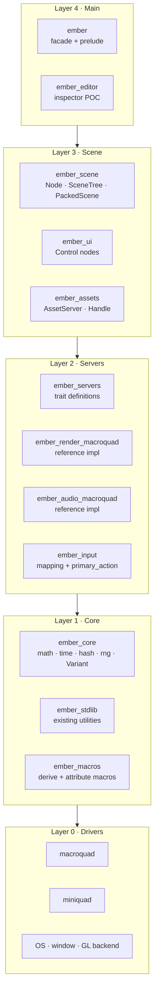
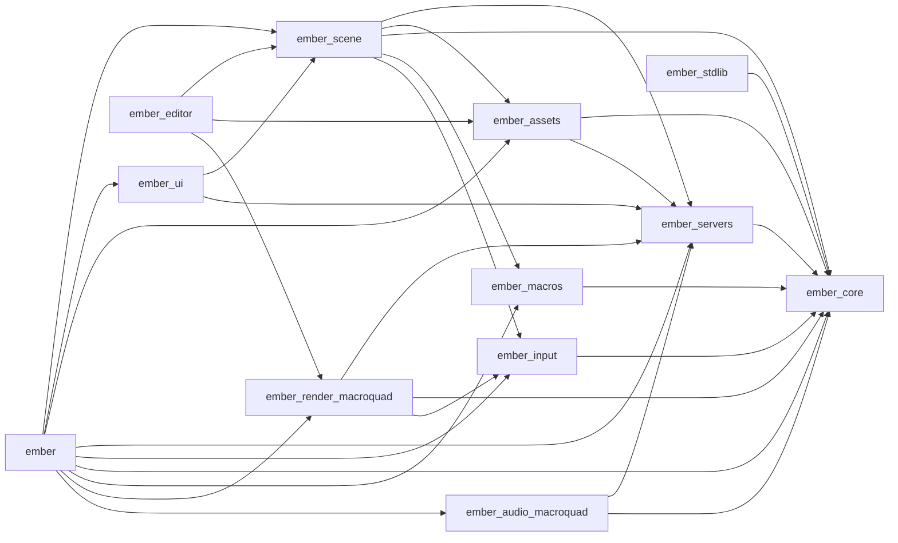
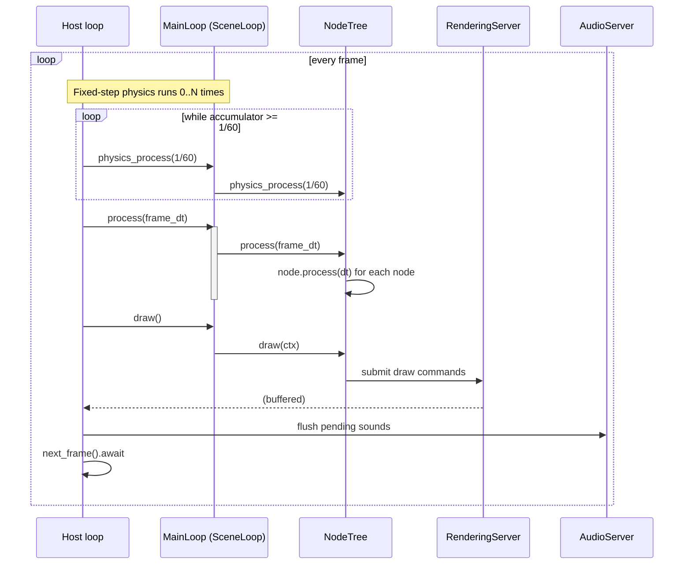
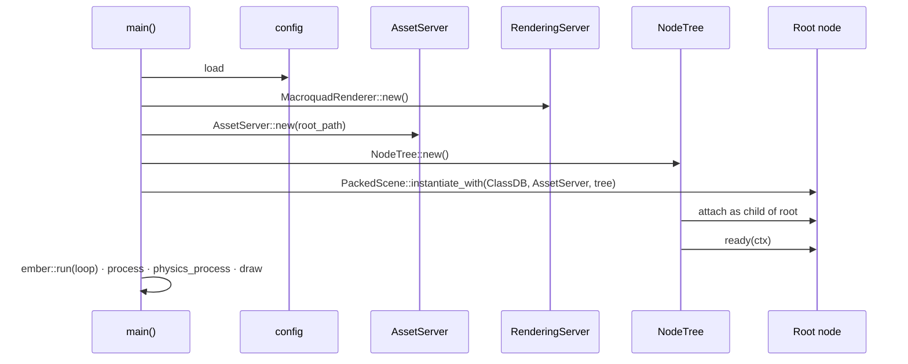

# 01 — Architecture

> **Status:** 🟡 partial — reviewed 2026-11-19; layers, crate map and xtask checks match code; `ember_ui`/`ember_editor` are stubs, `Plugin`/`juice` do not exist
> **Audience:** implementers, reviewers
> **Prerequisites:** [[00-overview]]

## 1. Purpose

Describe the engine's layer structure, crate map, and dependency rules.
This is the file you open when you need to decide **which crate your code
belongs in**, and **which crates you are allowed to import from it**.

If a change breaks a rule in §3, it is not reviewable — it is a redesign
proposal, and it belongs in [[50-design-decisions]]
first.

## 2. The five-layer model

Ember borrows Godot's five-layer decomposition, because that decomposition
survived a decade of Godot iterations and prevented Godot from collapsing
into a single monolith.



**Dependency direction is strictly downward.** A higher layer may import a
lower layer; the reverse is a compile error in a strict workspace, and a
review-blocking violation in a permissive one. This rule is enforced by
CI — see §5.

### 2.1 Layer responsibilities

| Layer | Responsible for | Does **not** know about |
|---|---|---|
| **L4 · Main** | Entry point (`ember::run`), `MainLoop` host, editor tooling | Concrete node types (only the tree) |
| **L3 · Scene** | Node trait, tree, lifecycle, assets, UI, scene format | How rendering happens, how input is polled |
| **L2 · Servers** | Backend-agnostic trait definitions; concrete backend impls | Scenes, nodes, game logic |
| **L1 · Core** | Math, time, hash, rng, `Variant`, `Object`/`ClassDB`, utilities | Rendering, input, game logic |
| **L0 · Drivers** | Platform, window, GL backend | Anything Ember-specific |

This is the same layering Godot uses, with the same rationale: **the Scene
layer is optional**. You can skip `ember_scene` and talk straight to
`ember_servers` (as `ember_stdlib` does today). But games will not — the
whole point of the POC is to make the Scene layer worth using.

## 3. Crate map and dependencies

### 3.1 Complete crate tree

```
ember_workspace/
├── crates/
│   ├── ember-core/                (L1)
│   ├── ember-macros/              (L1, proc-macro)
│   ├── ember-servers/             (L2, traits only)
│   ├── ember-render/
│   │   └── macroquad/             (L2, impl — package: ember-render-macroquad)
│   ├── ember-audio/
│   │   └── macroquad/             (L2, impl — package: ember-audio-macroquad)
│   ├── ember-input                (L2)
│   ├── ember-scene                (L3)
│   ├── ember-ui                   (L3, stub — empty)
│   ├── ember-assets               (L3)
│   ├── ember-editor               (L4, dev-only, placeholder)
│   ├── ember                      (L4, facade)
│   └── ember-stdlib/              (L1, kept as-is for utility functions)
├── xtask/                         (check-layers, check-macroquad)
└── games/
    ├── ember-wars/
    ├── jade-garden/
    └── … (17 total)
```

### 3.2 Per-crate dependency graph (allowed edges only)



> **Note:** the graph shows `ember_stdlib → ember_core` (one direction only).
> Earlier drafts described a cycle; that was a mistake. In practice,
> `ember_core` has **no** dependency on `ember_stdlib`, and `ember_stdlib`
> re-exports `ember_core` (`pub use ember_core::*`). Unlike a pure L1 crate it
> also depends on `macroquad` directly (see §5.3).

### 3.3 Crate purpose table

| Crate | Layer | One-line purpose |
|---|---|---|
| `ember_core` | L1 | Math, time, hash, rng, `Variant`, `Object`/`ClassDB` |
| `ember_stdlib` | L1 | Existing utilities kept as-is (input primitives, grid, collider, sprite, transform, persistence, config, layout, fonts, ui helpers); depends on `macroquad` |
| `ember_macros` | L1 | `#[derive(Node)]` (implemented); `#[signal]` is a no-op marker; `#[export]` is accepted but inert |
| `ember_servers` | L2 | Trait definitions, `MockRenderer`/`MockAudio`, and the `LinearPhysics` `PhysicsServer` backend (ADR-028) |
| `ember_render_macroquad` | L2 | Reference `RenderingServer` on macroquad |
| `ember_audio_macroquad` | L2 | Reference `AudioServer` on macroquad |
| `ember_input` | L2 | Backend-agnostic `Input` snapshot, `Key`/`MouseButton`/`GamepadButton`/`TouchPoint`, `primary_action`; action mapping *not yet implemented* |
| `ember_scene` | L3 | `Node` trait, `NodeTree`, `NodeContext`, `SignalTable`, `PackedScene`, `.escene` format, `SceneLoop` |
| `ember_ui` | L3 | Retained-mode `Control` nodes — *not yet implemented (empty crate)* |
| `ember_assets` | L3 | `AssetServer`, `Handle<T>`, UID registry (hot-reload *not yet implemented*, ADR-026) |
| `ember_editor` | L4 | Scene inspector (dev-only) — *not yet implemented (placeholder crate)* |
| `ember` | L4 | Facade: prelude re-exports, `run`/`run_window`, no logic |

### 3.4 Rule of thumb

When you cannot decide which crate a piece of code belongs in:

- **If it touches a GPU API** → not your problem, it belongs in a `_macroquad` crate.
- **If it defines a trait consumed by games** → `ember_servers` or `ember_scene`.
- **If it is pure math / data structure** → `ember_core`.
- **If it is a self-contained utility** → `ember_stdlib`.
- **If it depends on `ember_scene`** → Layer 3 (`ember_ui`) or Layer 4 (a game, `ember` or `ember_editor`).

## 4. Runtime view

### 4.1 Single-frame sequence

The execution model is **fixed-step physics + variable-step process**,
mirroring Godot's split. This matters because games that conflate the two
end up with lifecycle bugs — a cooldown that decrements by `dt` behaves
differently at 60 Hz than at 144 Hz, which is exactly the class of bug we
spent a whole session fixing in `ember-wars`.



The key property: a `Node`'s `process` sees `dt` (variable), and its
`physics_process` sees a constant `1/60`. Games put movement and collision
in `physics_process`; games put visual interpolation, tweens, and UI in
`process`.

### 4.2 Startup sequence



> Illustrative: `config` loading and exact constructor calls are up to the
> game's `main`; `ember::run` / `run_window` drive the loop.

### 4.3 Shutdown sequence

Reverse of startup. `finalize()` is best-effort (save progress, flush audio),
then servers drop in reverse dependency order. `MainLoop::finalize` is the
hook; `SceneLoop::finalize` calls `NodeTree::clear`, which finalizes every
node bottom-up. No node is dropped before
its children (`NodeTree` owns the arena and drops bottom-up).

## 5. Enforcement

Two rules have `xtask` checks (`cargo run -p xtask -- check-layers` and
`check-macroquad`), not just convention:

### 5.1 No crate imports a higher layer

`xtask check-layers` reads `cargo metadata` and asserts that every
engine crate's dependency edges match the allowed table in
`xtask/src/check_layers.rs` (the graph in §3.2). A violation exits non-zero. This prevents the slow spiral where `ember_core`
"just needs a `Node` for convenience" and the layer structure dissolves.

### 5.2 No crate imports `macroquad` except the `_macroquad` crates

`xtask check-macroquad` verifies that `macroquad`/`miniquad` imports
appear only in `ember_render_macroquad`, `ember_audio_macroquad` or an
explicit allowlist (today including `ember_stdlib` and the games). This is the seam that lets
v0.2 add a wgpu backend without a single game rewrite.

### 5.3 Current state (`main` branch)

| Rule | Status |
|---|---|
| §5.1 Layer order | ✅ `xtask check-layers` implemented |
| §5.2 `macroquad` isolation | ⚠️ `xtask check-macroquad` implemented with an allowlist; `ember_stdlib` and games still import macroquad |
| `ember_core` has no `ember_*` deps | ✅ true |
| `ember_stdlib` depends only on `ember_core` (among `ember_*`) | ✅ true |

Whether these run in CI is tracked in [[40-roadmap]].

## 6. What survives, what dies

### 6.1 Survives unchanged

- **`ember_core`** — math, rng, hash, time. The planned `Cooldown` constructor
  rename (`new`→`running`, deprecate `new`) is *not yet implemented*: `Cooldown`
  still has `new`, `with_duration` and `ready`, with no `#[deprecated]`.
- **`ember_stdlib`** — input primitives, grid, collider, sprite, transform,
  persistence, layout. These are useful regardless of the engine architecture.
  They gradually become a *facade over* `ember_core` and *complements to*
  `ember_scene` — but their public API stays.
- **All 17 games' logic code** — the `systems::update`, `resolve_attacks`,
  `resolve_projectiles`, etc. functions. Migration replaces the *wrapping*,
  not the *contents*.

### 6.2 Dies

- **Per-game `main.rs`** — replaced by `ember::run` / `run_window` driving a
  `MainLoop` implementation (games have not all migrated yet).
- **Per-game `juice.rs`** — to be extracted to `ember_stdlib::juice` (*not yet done* — no such module).
- **Per-game `audio.rs`** — replaced by `AudioServer` calls through `NodeContext`.
- **Per-game asset loading** — replaced by `AssetServer` + `Handle<T>`.
- **Per-game save/load** — replaced by `MainLoop::progress()` + a
  serialization helper in `ember_core`.
- **`macroquad` as a direct dependency of games** — routed through
  `ember_render_macroquad`.

### 6.3 Mutates

- **`ember_core::time::Cooldown`** — constructors to be renamed, `new` deprecated (*not yet done*).
- **`ember_stdlib::input::Input`** — extended with `primary_action` and touch/gamepad fields.
- **`ember_stdlib::juice::Juice`** *(planned; not yet present)* — promoted from per-game copies to a
  shared struct; gains a `tick` and stays identical otherwise.

## 7. Open questions

- **Q1:** Do we need `ember_physics` as a separate crate, or is
  `ember_stdlib::collider` enough? *Resolved (ADR-028):* `PhysicsServer` with the `LinearPhysics` backend lives in `ember_servers`; `collider` stays in
  `ember_stdlib` unmigrated; a real physics solver is v0.2+.
- **Q2:** Does `ember_ui` live in `ember_scene` or its own crate? *Provisional:*
  own crate, so games with no UI (bullet-hell, asteroids) don't pull it in.
- **Q3:** Where does the `Plugin` trait live? *Provisional:*
  `ember_core::plugin`, one implementation per game's `lib.rs`. It's the
  only extension point we commit to. *Not yet implemented — no `plugin` module.*
- **Q4:** Should `ember_servers` have its own test doubles (mock rendering)?
  *Resolved differently:* `MockRenderer` and `MockAudio` ship in
  `ember_servers` and are used by scene tests.

## 8. Cross-references

- Invariants → [[02-principles]]
- Node/Scene deep dive → [[10-nodes-and-scenes]]
- Server trait contracts → [[12-servers]]
- Roadmap gates → [[40-roadmap]]
- Decision log → [[50-design-decisions]]
- Glossary → [[51-glossary]]
