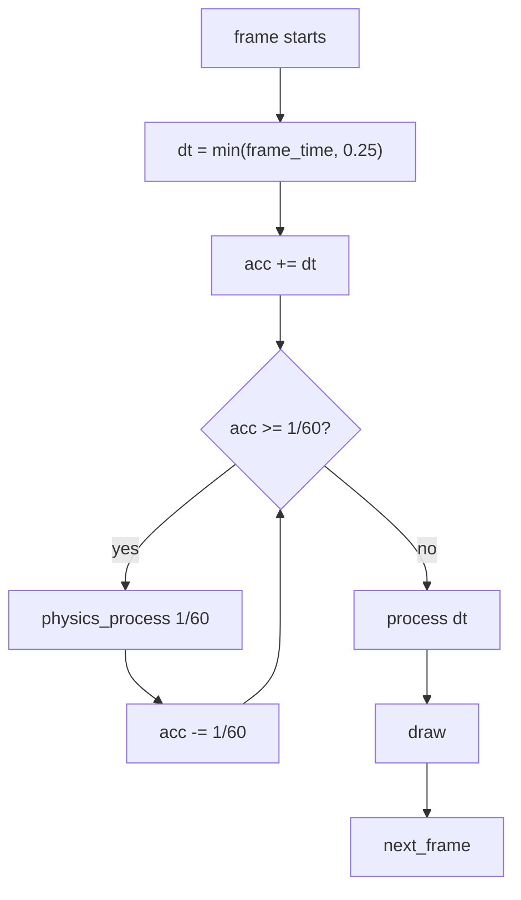
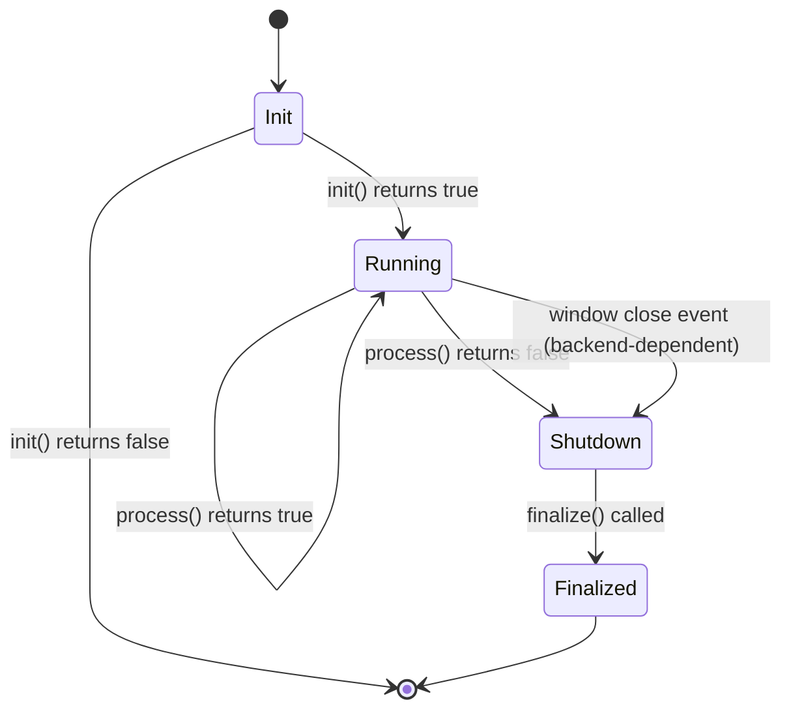

# 14 — Main Loop

> **Status:** 🟡 partial — reviewed 2026-11-19; `MainLoop`, fixed-step runner (`ember::run`/`run_window`) and `SceneLoop` implemented; `progress`/dirty-save hook and profiling are not
> **Audience:** game authors, implementers
> **Prerequisites:** [[10-nodes-and-scenes]], [[12-servers]]

## 1. Purpose

Explain how the engine runs a game: the `MainLoop` trait, fixed-step
physics, variable-step process, pause semantics, quit, and the progress
save hook. This is the file you read when you write your game's `main`.

Ember's main loop is small — around 100 lines. The point of this document
is not to describe complex machinery, but to explain **why it is so
small**: the loop's simplicity is what makes every game's `main.rs` ten
lines instead of a hundred.

## 2. The MainLoop trait

```rust
pub trait MainLoop {
    /// Initialise the game. Return `false` to abort startup.
    fn init(&mut self) -> bool { true }

    /// Called every frame. Return `false` to quit.
    fn process(&mut self, dt: f32) -> bool;

    /// Called 0..N times per frame at a fixed `1/60` dt.
    fn physics_process(&mut self, fixed_dt: f32) {}

    /// Called once per frame after process. `&mut self` because
    /// rendering backends are stateful (ADR-022).
    fn draw(&mut self) {}

    /// Called once before shutdown. Best-effort.
    fn finalize(&mut self) {}

    /// The window size: before the first frame, then on change (ADR-041).
    fn resize(&mut self, width: f32, height: f32) {}
}
```

The trait and its constants live in `ember_core::main_loop`
(`FIXED_DT = 1/60`, `MAX_FRAME_DT = 0.25`; `ember::MainLoop` re-exports the
trait). The common case is `ember_scene::SceneLoop`, which adapts a
`NodeTree` plus its backends to `MainLoop` (`init` flushes the tree so
`ready` runs, `process`/`physics_process` run the tree passes, `draw` does
`begin_frame` → `tree.draw` → `end_frame` → `audio.flush`, `finalize` calls
`tree.clear`). There is no derive macro or `Game` trait; a game with
fine-grained needs implements `MainLoop` directly.

## 3. The loop

### 3.1 Algorithm

```rust
// ember_core::main_loop — the frame algorithm, backend-agnostic and tested headlessly
pub struct FrameStepper { accumulator: f32 }
impl FrameStepper {
    /// clamp dt to [0, MAX_FRAME_DT] → physics_process ×0..N at FIXED_DT
    /// → process(dt) → draw() unless process returned false
    pub fn frame<L: MainLoop + ?Sized>(&mut self, game: &mut L, frame_dt: f32) -> bool;
}
/// init → one frame per dt → finalize, no window (tests, tools)
pub fn run_headless<L, I>(game: &mut L, frame_dts: I) -> HeadlessRun;

// ember_render_macroquad::run, re-exported as ember::run
pub async fn run<L: MainLoop + InputSink>(mut game: L) {
    if !game.init() {
        return;
    }
    let mut stepper = FrameStepper::new();
    loop {
        let dt = get_frame_time();
        game.set_input(poll_input());   // one Input snapshot per frame
        if !stepper.frame(&mut game, dt) {
            break;
        }
        next_frame().await;
    }
    game.finalize();
}

/// Opens a window and runs `game` (blocking).
pub fn run_window<L: MainLoop + InputSink + 'static>(title: &str, width: i32, height: i32, game: L);
```

The runner requires `InputSink` (`ember_input`) so it can hand each frame's
`Input` to the game; `SceneLoop` implements it.

### 3.2 What each phase does

| Phase | Frequency | `dt` | Purpose |
|---|---|---|---|
| `physics_process` | 0..N per frame | constant `1/60` | movement, collision, cooldowns |
| `process` | 1 per frame | variable (frame time) | UI, tweens, input polling, visual interpolation |
| `draw` | 1 per frame | — | render |

The split is what makes games frame-rate independent. A cooldown that
should last 0.3 seconds ticks down in `physics_process`, so it lasts
exactly 0.3 seconds whether the frame rate is 30, 60, or 144.

**This is the class of bug we spent a whole session fixing in
`ember-wars`.** A `Cooldown` that decrements by `dt` in `process`
behaves differently at different frame rates. A `Cooldown` that
decrements by `1/60` in `physics_process` does not.

## 4. Fixed-step algorithm in detail

### 4.1 The accumulator



### 4.2 Why the `MAX_FRAME_DT` cap

If a frame takes 5 seconds (e.g. the OS suspended the process, or a
debugger paused execution), the accumulator would spike to 5.0, causing
300 `physics_process` calls in one frame. This is called the **spiral of
death** — each `physics_process` makes the next frame take even longer.

The cap at `0.25` seconds (4 frames worth) prevents this. Any `dt` above
the cap is treated as `0.25`. The remaining time is silently dropped;
game logic can't assume any `dt` value.

### 4.3 Why 1/60 exactly

60 Hz is a well-understood tick rate that:

- Matches display refresh rates on most monitors.
- Is a divisor of 30, 60, 120, 240 — common refresh rates.
- Leaves plenty of headroom in a 60 fps budget.

A future game could override the tick rate (120 Hz for physics-heavy
games, 30 Hz for CPU-light games) via a constant. v0.1 hardcodes 60.

## 5. Pause semantics

### 5.1 What pause means

`process` and `physics_process` are skipped, `draw` still runs. This is
what every player expects — the frame is still drawn, but the world is
frozen.

### 5.2 How to pause

The `MainLoop` implementation exposes a `pause()` / `resume()` /
`is_paused()` API on a wrapping type (usually the game's `GameState`).

```rust
pub struct App {
    state: AppState,     // Menu, Playing, Paused, Won, Lost
    // ...
}

impl MainLoop for App {
    fn process(&mut self, dt: f32) -> bool {
        match self.state {
            AppState::Playing => self.update(dt),
            AppState::Paused => self.handle_pause_input(),
            _ => {}
        }
        true
    }

    fn physics_process(&mut self, fixed_dt: f32) {
        if self.state == AppState::Playing {
            self.physics(fixed_dt);
        }
    }
}
```

### 5.3 What the engine does automatically

**Nothing.** Pause is entirely game-side. The engine doesn't have a
`pause` flag; the game's `process` / `physics_process` implementations
decide whether to run based on `self.state`.

This is deliberate — some games want background animations during
pause (a spinning logo), some want pause to also stop sounds. A single
engine-level `pause` flag would force one policy on every game.

### 5.4 Common pause pattern

```rust
fn process(&mut self, dt: f32) -> bool {
    if self.input.pressed(Key::Escape) {
        self.toggle_pause();
    }
    match self.state {
        AppState::Playing => self.tick_playing(dt),
        AppState::Paused => self.tick_paused(dt),
        _ => {}
    }
    true
}

fn tick_paused(&mut self, _dt: f32) {
    // draw continues (via self.draw), but no game logic
}
```

## 6. Quit

### 6.1 How to quit

Return `false` from `process`:

```rust
fn process(&mut self, _dt: f32) -> bool {
    if self.input.pressed(Key::Escape) && self.state == AppState::Menu {
        return false;
    }
    self.update(_dt);
    true
}
```

The runner exits the loop and calls `finalize`. `SceneLoop` also stops when
a node calls `ctx.quit()` (`NodeTree::request_quit`) or
`SceneLoop::request_quit()`.

### 6.2 What happens on quit

1. `process` returns `false`.
2. Loop exits.
3. `MainLoop::finalize()` is called — the last chance to save progress.
   For `SceneLoop` this calls `NodeTree::clear`, running every node's
   `Node::finalize` bottom-up.
4. The game value (and with it the backends) is dropped when `run` returns.

`Node::finalize` takes no context, so it cannot use servers (see
[[12-servers#3.3 Destruction|12-servers §3.3]]).

## 7. Progress save

> *Not yet implemented.* `MainLoop` has no `progress` / `progress_mut`
> methods, no `Serializable` trait, no dirty flag and no automatic save;
> games persist progress themselves (e.g. via `ember_stdlib::persistence`).
> The design below is the plan.

### 7.1 The hook

```rust
pub trait MainLoop {
    // ...

    /// Return the current progress to persist.
    fn progress(&self) -> Option<&dyn Serializable> { None }

    /// Called by the host when a save is due.
    fn progress_mut(&mut self) -> Option<&mut dyn Serializable> { None }
}
```

### 7.2 When is a save due

The `MainLoop` wrapper (or `ember::run`) calls `progress_mut()` and
serializes it:

- On quit (`process` returns `false`).
- On state change to `Won` or `Lost` (the game decides).
- On explicit `save_now()` calls.

### 7.3 The dirty flag

If the game mutates progress (e.g., player collected a coin), it sets a
`dirty` bit. The wrapper checks `is_dirty()` after `process`, and saves
if dirty.

```rust
impl Game {
    fn add_score(&mut self, points: u32) {
        self.progress.best_score = self.progress.best_score.max(points);
        self.dirty = true;
    }
}
```

The next frame, the wrapper saves and clears the bit. This bounds the
frequency of disk writes to "at most once per frame".

## 8. Lifecycle states



### 8.1 The `init` phase

Called once before the loop. Game should:

- Load initial assets.
- Create the root node.
- Set initial state to `Menu` or `Playing`.

If `init` returns `false`, the loop exits immediately. This is how a
game reports "missing critical asset, refusing to run".

### 8.2 The `finalize` phase

Called once after the loop exits. Game should:

- Save any final progress.
- Flush audio queues (if not automatic).
- Clean up log files.

**Do not use servers** in `finalize`. They may already be shutting down.

## 9. Examples

### 9.1 Minimal loop

```rust
struct Minimal { frames: u64 }

impl MainLoop for Minimal {
    fn process(&mut self, _dt: f32) -> bool {
        self.frames += 1;
        self.frames < 60
    }
}

impl InputSink for Minimal {
    fn set_input(&mut self, _input: Input) {}
}

fn main() {
    ember::run_window("Minimal", 800, 600, Minimal { frames: 0 });
}
```

### 9.2 Loop with fixed-step physics

```rust
struct PhysicsGame {
    physics: PhysicsWorld,
    renderer: RendererState,
}

impl MainLoop for PhysicsGame {
    fn physics_process(&mut self, dt: f32) {
        self.physics.step(dt);
    }

    fn process(&mut self, dt: f32) -> bool {
        self.renderer.interpolate(dt);
        self.renderer.update(dt);
        true
    }

    fn draw(&mut self) {
        self.renderer.draw();
    }
}
```

### 9.3 Loop with pause

```rust
struct Pausable {
    state: AppState,
    world: World,
}

impl MainLoop for Pausable {
    fn process(&mut self, dt: f32) -> bool {
        if self.world.input.pressed(Key::Escape) {
            self.toggle_pause();
        }
        if self.state == AppState::Playing {
            self.world.tick(dt);
        }
        true
    }

    fn physics_process(&mut self, dt: f32) {
        if self.state == AppState::Playing {
            self.world.physics_tick(dt);
        }
    }

    fn draw(&mut self) {
        self.world.draw(&self.state);
    }
}
```

## 10. Design notes

### 10.1 Why a trait, not a function

A trait lets the game own its state and the loop call into it. A
function would have to thread `&mut Game` through every callback, which
is what the trait already does implicitly.

The trait also lets the `ember_editor` implement `MainLoop` for its own
"play preview" mode without knowing about the game's internals.

### 10.2 Why not just `dt` and let games decide

Because games get it wrong. The `ember-wars` bug (31 test failures from
`Cooldown::new` misuse) is exactly the class of bug that fixed-step
physics prevents. Making the split explicit in the engine — with a
trait method for each — is what makes it hard to get wrong.

### 10.3 Why the cap at 0.25s

Because unbounded catch-up is worse than dropping frames. A game that
misses 3 frames should not try to simulate 3 extra `physics_process`
calls in the next frame — that makes the next frame even slower, causing
a feedback loop. Dropping the missed frames is what AAA engines do.

### 10.4 Why pause is game-side

Because pause policies differ. A menu that keeps its background animating
must process while paused; a game that stops all audio must hook pause
into `AudioServer`. Forcing one policy would exclude the other.

## 11. Open questions

- **Q1:** Should the fixed tick rate be configurable? *Provisional:* yes
  in v0.2 (`MainLoop::tick_rate() -> f32`, default 60). Today `FIXED_DT` is a constant.
- **Q2:** Should `draw` be `&self` or `&mut self`? *Resolved (ADR-022):*
  `&mut self`, because rendering backends are stateful. Node-level
  `Node::draw` stays `&self`.
- **Q3:** Should the loop expose per-phase timing (for profiling)?
  *Provisional:* yes, via `ember_profiling` macros (*not yet implemented*). The loop calls
  `profile_scope!("physics")` around each phase. No-op unless the
  feature is enabled.
- **Q4:** Should `finalize` be async? *Provisional:* no — it runs after
  the event loop exits, and async here would complicate the shutdown
  path for no benefit.

## 12. Cross-references

- Node lifecycle under the loop → [[10-nodes-and-scenes#3. Lifecycle|10-nodes-and-scenes.md §3]]
- Server flush timing → [[12-servers#3. Server lifecycle|12-servers.md §3]]
- `Cooldown` fixed-step usage → [[20-ember-core]]
- The `GameState` enum → [[51-glossary#G|51-glossary.md]]
- Full API → [[20-ember-core]]
