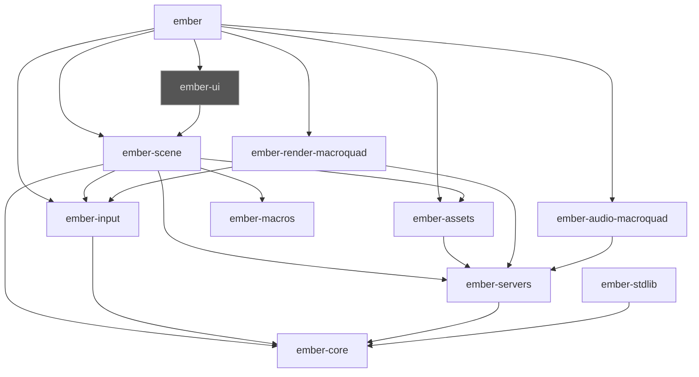

# Engine crates — Map of Content

Numbers are from a static read of the `main` working tree on 2026-11-22 (`.rs` files, total lines, `#[test]` count). Tests were **not executed** (no Rust registry access in the analysis environment).

| Crate | Layer | Files | Lines | `#[test]` | Status |
|---|---|---:|---:|---:|---|
| [[ember-core]] | L1 · Core | 22 | 2514 | 126 | 🟢 Substantial |
| [[ember-macros]] | L1 · Core (proc-macro) | 2 | 137 | 0 | 🟡 Minimal |
| [[ember-stdlib]] | L1 · Core (legacy utilities) | 20 | 2709 | 112 | 🟡 Legacy layer still used by 16/17 games and still depends on macroquad (allow-listed) |
| [[ember-servers]] | L2 · Servers (traits) | 9 | 1303 | 19 | 🟢 Traits match ADR-016/017/028 |
| [[ember-render-macroquad]] | L2 · Servers (backend) | 6 | 695 | 9 | 🟢 All trait methods implemented; runner does fixed-step accumulator |
| [[ember-audio-macroquad]] | L2 · Servers (backend) | 3 | 184 | 5 | 🟢 Implemented, small |
| [[ember-input]] | L2 · Servers | 8 | 758 | 33 | 🟡 Snapshot + ADR-010 actions done |
| [[ember-scene]] | L3 · Scene | 25 | 2910 | 53 | 🟢 The most complete crate: tree, deferred spawn/despawn, signals with deterministic order / stale-target / cycle / scoped tests, ` |
| [[ember-assets]] | L3 · Scene | 8 | 815 | 7 | 🟡 Per ADR-026: synchronous, type-driven |
| [[ember-ui]] | L3 · Scene | 1 | 4 | 0 | ⬜ **Stub** — 4-line `lib |
| [[ember-editor]] | L4 · Main | 2 | 19 | 1 | ⬜ **Placeholder** — `lib |
| [[ember]] | L4 · Main (facade) | 2 | 108 | 0 | 🟢 Facade works; used by `pong` and `hello_scene` |
| **Total** | | | **12156** | **365** | |

Layer rules: [[01-architecture#2. The five-layer model|five-layer model]] · enforced by `xtask check-layers` / `check-macroquad` (see [[ember-servers]] and [[Doc–Code Discrepancies]]).

*Actual dependency edges from the crates' `Cargo.toml` (ember-editor has none).*
