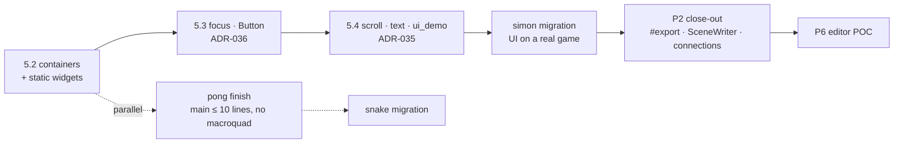

# Roadmap review — 2026-11-22 (evening)

Second review of [[40-roadmap]] today, after closing Phase 0, Phase 4, the Phase 5 entry gate and session 5.1. Morning baseline: [[Progress Evaluation 2026-11-22]] (≈ 31 %).

## Where every phase stands

| Phase | Est. sessions | Done | State | What's left |
|---|---:|---:|---|---|
| P0 Foundations | 1 | 100 % | ✅ closed | — |
| P1 Scene core | 2.5 | 95 % | 🟢 | run `hello_scene` once headless (`run_headless` now makes it possible) |
| P2 Serialization | 4.5 | 65 % | 🟡 | `#[export]` codegen, `SceneWriter`/`to_ron` from live nodes, scene-declared connections, font/audio asset loaders, hot-reload watcher |
| P3 Signals | 2 | 90 % | 🟢 | scene-declared connections (needs P2) |
| P4 Servers | 3 | 100 % | ✅ closed (ADR-033) | games' isolation moved to P7 |
| P5 UI | 2.5 → **4** | 25 % | 🟡 5.1 done | 5.2 containers + static widgets, 5.3 focus/buttons/mouse, 5.4 scroll/text/demo |
| P6 Editor POC | 3.5 | 0 % | ⬜ blocked | needs P5 widgets **and** P2 close-out |
| P7 Migration | 12.5 | 5 % | 🟡 1/17 | pong unfinished; 16 games |
| P8 Cleanup | 1 | 10 % | ⬜ | `juice.rs` gone; `audio.rs` ×4, deprecated `Cooldown` names, `CHANGELOG.md` |

**Effort-weighted progress ≈ 12.5 / 34 sessions ≈ 37 %** (P5 re-estimated from 2.5 to 4 sessions). Roughly **20 sessions** remain, **12 of them migration**.

## What changed today

| Commit(s) | Effect on the roadmap |
|---|---|
| `f1764ad` merge, `2e4a311`, `5aa64c2`, `45454fa` | Phase 0 closed (shared juice/music, `Cooldown::running/ready`, `FrameStepper` + `run_headless`) |
| baseline | 2,065 tests green, clippy/fmt green — the README's "32 failing" was stale |
| `8cc3112` | ADR-030: `#[derive(Node)]` + `impl Node for T` works (spec form) |
| `a1072f5`, `e190c21` | ADR-031 clip stack; camera sign bug fixed |
| `7bde4b0` | ADR-032 typed text, wheel, editing keys |
| `c0fde0c` | ADR-033: Phase 4 closed; allowlist is now a per-game progress bar |
| `bb0a44e` | [[24-ember-ui]] frozen (first ✅ spec) |
| `a5d5470`, `cdbc078` | Session 5.1: `ember-ui` foundations (ADR-034) |

## Findings

1. **The "strictly sequential" rule doesn't describe the real plan.** P5 and P7 can and should run in parallel (P7 only needs P4). The roadmap now says so in its status box.
2. **P6 has a hidden dependency on P2.** The editor must *save* scenes; there is no `SceneWriter` and `#[export]` is inert. P2's close-out has to come before P6, not just "P2 complete" at some point in the past.
3. **P5 was under-estimated (2.5 → 4 sessions).** Session 5.1 showed the spec glosses over how controls live in the tree (ADR-034), and two more engine touches are needed:
   - **ADR-035 (planned, 5.4):** a *post-children draw hook* on `Node` (e.g. `draw_after_children`) so `ScrollContainer` can pop its clip after its children draw. Without it, scroll clipping can't work.
   - **ADR-036 (✅ 5.3, `45e44da`):** control event handlers have no `NodeContext`, so a `Button` can't emit `ButtonPressed` itself. `UiRoot` routes input and emits on the control's behalf (controls report "pressed/submitted" through `ControlBase`).
4. **Pong is "migrated" but not done** (20-line `main.rs`, `macroquad::Color`). It's the reference migration; finishing it is cheap and sets the pattern for the other 16.
5. **Specs-first is only partly real.** One spec is frozen (24). Freeze 21 (scene), 22 (servers), 25 (assets), 30 (`.escene`) as their phases close.
6. **Verification gap.** The analysis environment can't build the workspace (no crates.io); code is checked with real crates + stand-ins, and `make pre-push` on the Mac is the final gate. Keep that rule: never push without it.

## Re-plan (next ~10 sessions)

| # | Step | Phase | Sessions |
|---|---|---|---:|
| 1 | 5.2: `VBox`, `HBox`, `Stretch`, `Label`, `Panel`, `Image`; built-ins registered in `UiRoot::new`; `ember` facade re-exports `ember_ui` | P5 | 1 |
| 2 | Finish pong (`ember_core::Color`, `ember::run_scene` helper → `main.rs` ≤ 10 lines, drop it from the allowlist) | P7 | 0.5 |
| 3 | 5.3: `FocusManager`, `Button`, mouse routing, ADR-036 | P5 | 1 |
| 4 | 5.4: ADR-035 hook, `ScrollContainer`, `TextInput`, `ui_demo` + visual checks (Retina scissor, wheel direction) | P5 | 1–1.5 |
| 5 | Migrate snake, then simon (first game using `ember-ui`) | P7 | 2 |
| 6 | P2 close-out: `#[export]` → `set_property`/serialize codegen, `SceneWriter`, scene connections; freeze 21/25/30 | P2/P3 | 2 |
| 7 | P6 editor POC | P6 | 3.5 |

## Risks

| Risk | Mitigation |
|---|---|
| ADR-035 changes `ember-scene`'s draw pass | Additive default method; covered by `tree_ordering` tests |
| Migration effort (12 sessions) dominates | Finish pong as the template; migrate in [[41-migration-guide]] order; one allowlist line per PR |
| Editor scope creep | Keep the POC to load → select → edit one property → save (roadmap §9) |
| Untested macroquad paths (scissor DPI, wheel sign, input polling) | Visual checklist in `ui_demo` (5.4) |

Related: [[Roadmap Tracker]] · [[Next Phase Plan — Phase 5 UI]] · [[ADR Index]] · [[Commit & Push]]
