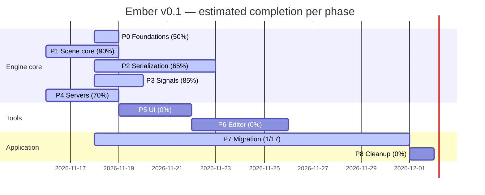

# Roadmap tracker

Checklist of every **exit criterion** in [[40-roadmap]], ticked against the `main` branch on 2026-11-22. Tick boxes as work lands. ⚑ = done only on the unmerged branch.

## Phase 0 — Foundations
- [ ] `cargo clippy --workspace --all-targets -- -D warnings` passes *(README: not green)*
- [ ] `cargo test --workspace --no-fail-fast` passes *(unverified)*
- [x] New APIs are additive
- [ ] `ember_stdlib::juice` has unit tests ⚑
- [ ] `MainLoop::run` integration test (headless order `init/process/draw/finalize`)
- [ ] `Cooldown::running` / `Cooldown::ready(d)` + `#[deprecated]` aliases ⚑
- [x] `primary_action()` *(in `ember-input`)*

## Phase 1 — Scene core
- [x] `NodeTree` + `Sprite`-like node rendered via `ember_render_macroquad` (`crates/ember/examples/hello_scene.rs`, build-verified only)
- [x] process order test — `tests/tree_ordering.rs`
- [x] ready order (bottom-up) test — `tests/ready_ordering.rs`
- [x] stale `NodeId` test — `tests/stale_id.rs`

## Phase 2 — Serialization
- [ ] `#[derive(Node)]` struct instantiable via `ClassDB::instantiate` *(needs `Default` + `register_node`; works, but derive can't carry behaviour)*
- [x] `PackedScene` round-trips through `to_ron()` — `tests/packed_scene.rs`
- [x] hand-written `player.escene` instantiates into a `NodeTree`
- [x] `AssetServer` loads PNG → `TextureId` (with renderer, ADR-026)
- [x] UID registry persisted (`uid_registry.ron`)
- [ ] `#[export]` serialization · `SceneWriter` · font/audio loaders · hot-reload watcher

## Phase 3 — Signals
- [x] Pong paddle→score via signal (`PointScored`)
- [x] deterministic dispatch order — `tests/signal_dispatch_order.rs`
- [x] stale targets skipped — `tests/signal_stale_target.rs`
- [x] cyclic signals don't overflow — `tests/signal_cycle.rs`
- [x] `ScopedConnection` drop disconnects — `tests/scoped_connection.rs`
- [ ] scene-declared connections wired from `.escene`

## Phase 4 — Servers
- [ ] `grep -rn "use macroquad" crates/` only in backends *(ember-stdlib allow-listed)*
- [x] `xtask check-layers` exists *(pass/fail unverified)*
- [x] `MockRenderer` drives a `NodeTree` and records calls
- [x] `LinearPhysics` backend; `ctx.physics()`
- [ ] `ember_stdlib::collider` migrated into `LinearPhysics`

## Phase 5 — UI
- [ ] `VBox` with 3 `Button`s, Tab/Enter navigation
- [ ] `ScrollContainer` clips
- [ ] `TextInput` accepts text
- [ ] `Theme::dark()`

## Phase 6 — Editor POC
- [ ] opens `player.escene`, shows `Player / Sprite / Hitbox`
- [ ] property panel shows `texture`, `size`
- [ ] edit `size` → preview updates
- [ ] save round-trips

## Phase 7 — Migration
Per game: `main.rs` ≤ 10 lines · logic unchanged · scenarios green · no `macroquad`.
- [ ] snake
- [ ] pong *(on NodeTree + signal; `main.rs` 20 lines; still imports macroquad Color)*
- [ ] simon
- [ ] memory
- [ ] minesweeper
- [ ] freecell
- [ ] breakout
- [ ] asteroids
- [ ] air-hockey
- [ ] bullet-hell
- [ ] pagoda
- [ ] taiji
- [ ] zhuo-ji
- [ ] bore-inc
- [ ] jade-garden
- [ ] accretion
- [ ] ember-wars → full checklist in [[42-acceptance-tests]]

## Phase 8 — Cleanup
- [ ] no `Cooldown::new` / `with_duration` call sites ⚑
- [ ] no `juice.rs` in games ⚑
- [ ] no `audio.rs` in games
- [ ] workspace tests + clippy green
- [ ] `CHANGELOG.md`
